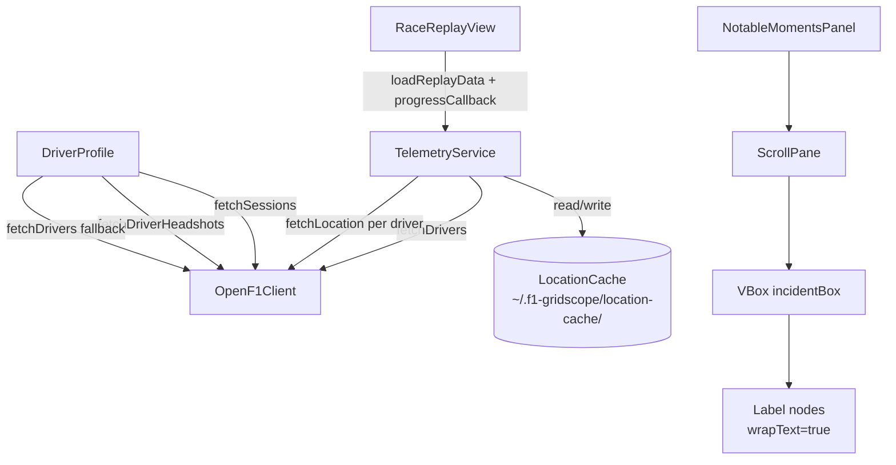
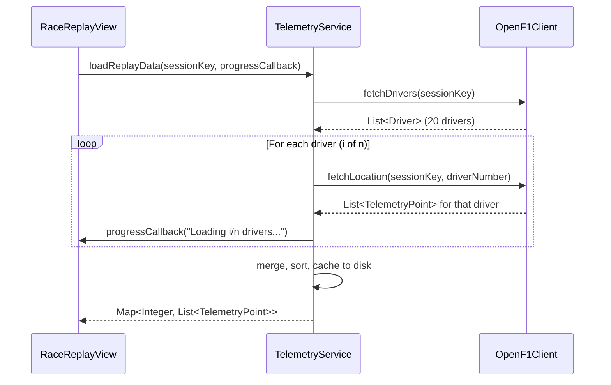
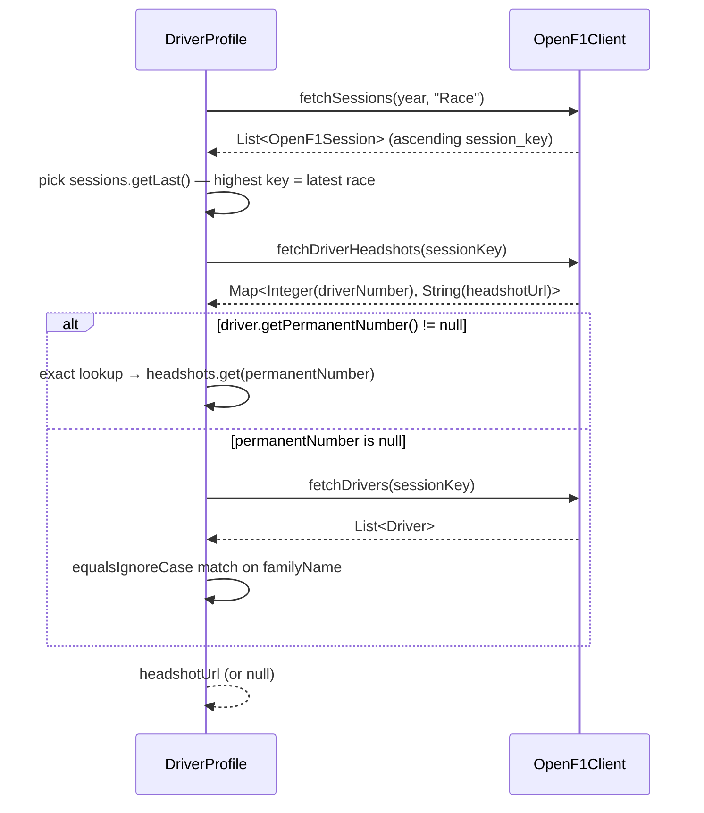
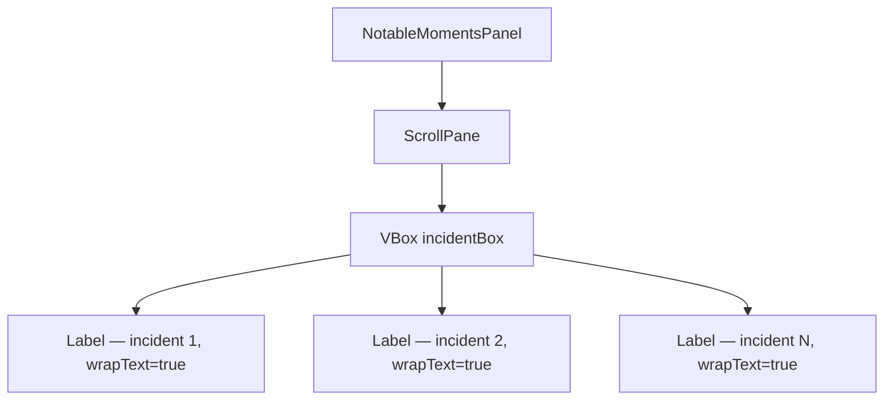

# Design Document: Bug Fixes — Race Replay, Headshot Mismatch, Notable Moments

## Overview

This document covers the design for three targeted bug fixes in the F1 GridScope JavaFX desktop
application. The bugs affect: (1) race replay failing to load due to an HTTP timeout when fetching
all GPS data in a single request, (2) driver headshots being mismatched due to fuzzy name matching
on an unreliable session, and (3) the Notable Moments list clipping long incident text so that only
one line appears visible unless the row is clicked.

---

## Architecture

The three bugs are independent and each confined to a single file. The overall application
architecture is unchanged; only the internal behaviour of the affected methods is modified.



## Components and Interfaces

### Component 1: TelemetryService — `loadReplayData`

**Purpose**: Fetch per-driver GPS telemetry for a session, with progress reporting and disk
caching.

**Interface** (updated signature):
```java
public Map<Integer, List<TelemetryPoint>> loadReplayData(
        int sessionKey,
        Consumer<String> progressCallback) throws IOException
```

**Responsibilities**:
- Return cached data immediately if the cache file exists
- Fetch the driver list for the session via `OpenF1Client.fetchDrivers`
- Fetch location data per driver via `OpenF1Client.fetchLocation(sessionKey, driverNumber)`
- Invoke `progressCallback` after each driver fetch
- Guard against an empty driver list by returning an empty map
- Persist the merged result to disk after all drivers have been fetched

### Component 2: DriverProfile — `resolveHeadshot`

**Purpose**: Resolve the correct headshot URL for a driver using exact permanent-number lookup,
with a safe name-based fallback.

**Interface** (signature unchanged, internal logic rewritten):
```java
private String resolveHeadshot(Driver driver, int year)
```

**Responsibilities**:
- Return `driver.getHeadshotUrl()` directly if already populated
- Select the last (highest session key) race session for the year
- Perform an O(1) headshots map lookup keyed by `driver.getPermanentNumber()`
- Fall back to `equalsIgnoreCase` family-name matching only when `permanentNumber` is null or
  the map lookup yields null
- Return `null` (not throw) when sessions are empty or no match is found

### Component 3: NotableMomentsPanel — incident display area

**Purpose**: Display fully wrapped, scrollable incident and penalty descriptions.

**Interface** (new private helper):
```java
private void setIncidents(List<String> lines)
```

**Responsibilities**:
- Clear and repopulate `incidentBox` with `Label` nodes for each incident string
- Configure each label with `wrapText=true` and `maxWidth=Double.MAX_VALUE`
- Provide a `ScrollPane` with `fitToWidth=true` and no horizontal scroll bar

## Data Models

No data model changes are required. The existing models are used as-is:

### `Driver` (existing, no changes)

```java
class Driver {
    Integer permanentNumber;  // car racing number — used as lookup key in Bug 2 fix
    String  givenName;        // mapped from OpenF1 first_name
    String  familyName;       // mapped from OpenF1 last_name — used in fallback match
    String  headshotUrl;      // populated by fetchDrivers / fetchDriverHeadshots
    String  teamName;
    // ... other fields
}
```

**Validation rules used in fixes**:
- `permanentNumber` may be null for historical/pre-2014 drivers — callers must null-check
- `familyName` may be null — callers must null-check before calling `equalsIgnoreCase`
- `headshotUrl` may be null or blank — callers must check `!= null && !isBlank()`

### `TelemetryPoint` (existing, no changes)

```java
class TelemetryPoint {
    double x, y;
    String timestamp;
    int    driverNumber;
}
```

### Cache format (existing, no changes)

```java
Map<Integer, List<TelemetryPoint>>  // key = driverNumber
```

Stored as JSON at `~/.f1-gridscope/location-cache/session-{sessionKey}.json`.

## Error Handling

### Bug 1 — Partial driver fetch failure

If `fetchLocation` throws for one driver, the exception propagates out of `loadReplayData` and is
caught by `RaceReplayView.loadReplay()`'s existing `catch (Exception exception)` block, which
displays `"Replay failed: ..."`. This matches the current error-surface behaviour. No partial
results are cached.

### Bug 2 — Empty sessions / null headshot

`resolveHeadshot` is wrapped in `try/catch (Exception ignored)` already. Both new early-return
paths (`sessions.isEmpty()` → `return null`, permanent-number miss → fall through) avoid throwing.

### Bug 3 — Empty incident list

`setIncidents(List.of())` clears the VBox and adds nothing; the panel shows as blank. The caller
already guards this by passing the placeholder string for empty results.

## Testing Strategy

### Unit Testing Approach

Each fix has unit tests targeting the specific method changed. Tests use Mockito to mock
`OpenF1Client` and `AppContext`, avoiding real HTTP calls or JavaFX scene graph initialisation
where possible.

### Property-Based Testing Approach

Properties 1–8 (defined in the Correctness Properties section) are implemented as parameterised
or randomised unit tests.

**Property Test Library**: JUnit 5 with manual parameterisation or jqwik for property-based
generation. Properties 1, 2, 3, 4, 7, 8 are straightforward to parameterise. Properties 5 and 6
use constructed counter-example scenarios.

### Integration Testing Approach

No integration tests against the live OpenF1 API are required for these fixes. The mock-based
unit tests are sufficient to validate the changed logic.

---

### Root Cause

`TelemetryService.loadReplayData(int sessionKey)` calls
`openF1Client.fetchLocation(sessionKey, null)` — omitting the `driver_number` filter — which
asks the OpenF1 API for every GPS point recorded for every driver across an entire session. A full
race session can contain hundreds of thousands of rows. The `HttpClient` has a 30-second timeout
(`REQUEST_TIMEOUT = Duration.ofSeconds(30)`), so the request reliably times out and the
`OpenF1ClientException` propagates up to `RaceReplayView.loadReplay()`, where it surfaces as
`"Replay failed: ..."` in `statusLabel`.

### Fix Architecture



#### Key Design Decisions

**Per-driver fetching** — Replace the single bulk call with N individual calls, one per driver number.
Each call requests `location?session_key=X&driver_number=Y`, which returns a manageable set of
rows (typically a few thousand per driver) well within the 30-second timeout.

**Driver list source** — Obtain driver numbers by calling `openF1Client.fetchDrivers(sessionKey)`
first. This endpoint is already used elsewhere and reliably returns the active drivers for the
session. If the list is empty, return an empty map immediately (graceful guard).

**Progress reporting** — A `Consumer<String>` callback is added to `loadReplayData` so the caller
can push status updates onto the FX thread. `RaceReplayView.loadReplay()` passes a lambda that
calls `Platform.runLater(() -> statusLabel.setText(msg))`.

**Cache behaviour** — The existing cache path (`~/.f1-gridscope/location-cache/session-{key}.json`)
and JSON format (`Map<Integer, List<TelemetryPoint>>`) are preserved. The cache is written once
after all per-driver data has been collected, exactly as today.

**Sequential fetching** — Drivers are loaded sequentially rather than in parallel to avoid
overwhelming the rate-limited public API. Progress updates are emitted after each driver loads.

### Affected Files

| File | Change |
|---|---|
| `TelemetryService.java` | Rewrite `loadReplayData` to loop per-driver with a progress callback parameter |
| `RaceReplayView.java` | Pass progress lambda when calling `loadReplayData`; add intermediate `Platform.runLater` updates |

### Pseudocode

```pascal
PROCEDURE loadReplayData(sessionKey, progressCallback)
  INPUT: sessionKey : int, progressCallback : Consumer<String>
  OUTPUT: Map<Integer, List<TelemetryPoint>>

  cacheFile ← locationCacheDir / "session-{sessionKey}.json"
  IF cacheFile exists THEN
    RETURN deserialize(cacheFile)
  END IF

  drivers ← openF1Client.fetchDrivers(sessionKey)
  IF drivers IS EMPTY THEN
    RETURN emptyMap()
  END IF

  byDriver ← new HashMap()
  FOR i ← 0 TO drivers.size()-1 DO
    driver ← drivers.get(i)
    progressCallback.accept("Loading " + (i+1) + "/" + drivers.size() + " drivers...")
    points ← openF1Client.fetchLocation(sessionKey, driver.getPermanentNumber())
    points.sort(by timestamp)
    byDriver.put(driver.getPermanentNumber(), points)
  END FOR

  Files.createDirectories(locationCacheDir)
  serialize(byDriver, cacheFile)
  RETURN byDriver
END PROCEDURE
```

---

## Bug 2 — Verstappen/Norris Headshot Mismatch (Fuzzy Name Match)

### Root Cause

`DriverProfile.resolveHeadshot()` has two compounding problems:

1. **Wrong session** — it picks `sessions.get(0)`, the first session OpenF1 returns for the year.
   OpenF1 returns sessions in ascending order by `session_key`; the first session is typically an
   early-season practice, which may not have a full complement of drivers.

2. **Fuzzy last-name match** — it splits the Jolpica `fullName` to extract the family name, then
   calls `.contains(lastName)` against each OpenF1 driver's `familyName`. The substring match can
   cross-match surnames that share a stem (e.g. "Norris" matching a driver whose surname contains
   "norris").

3. **Field verification** — `OpenF1Client.fetchDrivers()` populates `driver.setFamilyName()` from
   `node.path("last_name")`, and `Driver.getFamilyName()` returns that field. The mapping is
   correct. The problem is the `.contains()` predicate, not a field-mapping bug.

### Fix Architecture



#### Key Design Decisions

**Session selection** — Use `sessions.getLast()` (Java 21) or `sessions.get(sessions.size()-1)`.
The highest `session_key` is the most recently indexed session, which in practice corresponds to the
last race of the season — the session with the most complete driver list.

**Exact number-based lookup** — `fetchDriverHeadshots(sessionKey)` already returns
`Map<Integer, String>` keyed by `driver_number`. The Jolpica `Driver` model carries
`permanentNumber` (populated from the Ergast/Jolpica API's `permanentNumber` field). A direct map
lookup `headshots.get(driver.getPermanentNumber())` is O(1) and unambiguous.

**Name fallback** — When `permanentNumber` is null (historical drivers, some pre-2014 entries),
fall back to fetching the full driver list and matching on `familyName` using
`equalsIgnoreCase` instead of `contains`.

### Affected Files

| File | Change |
|---|---|
| `DriverProfile.java` | Rewrite `resolveHeadshot` with session-last selection and permanent-number-first lookup |

### Pseudocode

```pascal
PROCEDURE resolveHeadshot(driver, year)
  INPUT: driver : Driver, year : int
  OUTPUT: String headshotUrl or null

  IF driver.getHeadshotUrl() IS NOT NULL AND NOT BLANK THEN
    RETURN driver.getHeadshotUrl()
  END IF

  sessions ← openF1Client.fetchSessions(year, "Race")
  IF sessions IS EMPTY THEN
    RETURN null
  END IF

  sessionKey ← sessions.getLast().getSessionKey()
  headshots ← openF1Client.fetchDriverHeadshots(sessionKey)

  IF driver.getPermanentNumber() IS NOT NULL THEN
    url ← headshots.get(driver.getPermanentNumber())
    IF url IS NOT NULL AND NOT BLANK THEN
      RETURN url
    END IF
  END IF

  // Fallback: name-based match with exact equality
  openF1Drivers ← openF1Client.fetchDrivers(sessionKey)
  lastName ← extractFamilyName(driver.getFullName())
  IF lastName IS NULL THEN
    RETURN null
  END IF
  RETURN openF1Drivers.stream()
    .filter(d → d.getFamilyName().equalsIgnoreCase(lastName))
    .map(Driver::getHeadshotUrl)
    .filter(url → url IS NOT NULL AND NOT BLANK)
    .findFirst()
    .orElse(null)
END PROCEDURE
```

---

## Bug 3 — Notable Moments List: Text Clipped, Expands on Click

### Root Cause

`NotableMomentsPanel` creates `incidentList = new ListView<String>()` with no custom cell factory.
The default `ListCell` renders text in a single, non-wrapping line. Long incident descriptions
(e.g. `"[Penalty — 1] Drive-through penalty for causing a collision at Turn 1 after rejoining the
track in an unsafe manner during the opening lap"`) are clipped at the cell width.

The appearance of text "expanding on click" is caused by JavaFX's default selection styling
triggering a cell repaint. It is a visual artifact, not actual wrapping.

### Fix Architecture

The simplest and most robust fix is to replace the `ListView<String>` with a `VBox` of `Label`
nodes inside a `ScrollPane`. This avoids JavaFX's cell-recycling mechanism entirely and sidesteps
the difficulty of making `ListView` row height dynamic.



#### Key Design Decisions

**Replace `ListView<String>` with `ScrollPane` + `VBox`** — Labels inside a VBox naturally grow
to their content height. A `ScrollPane` provides the same scrollability that `ListView` offered.
This is simpler than fighting ListView's fixed-cell-height recycling model.

**Label configuration** — Each `Label` gets:
- `setWrapText(true)` — enables multi-line wrapping
- `setMaxWidth(Double.MAX_VALUE)` — allows the label to expand to fill the available width
- `VBox.setVgrow(label, Priority.NEVER)` — labels size to content; the VBox grows as needed

**Separator between items** — A thin `Separator` node between items improves legibility.

**Field name** — rename `incidentList` to `incidentBox` (a `VBox`) to reflect the type change.
All existing callers just call `.getItems().setAll(lines)` which is replaced with a helper method
`setIncidents(List<String> lines)` that clears and repopulates the VBox.

### Affected Files

| File | Change |
|---|---|
| `NotableMomentsPanel.java` | Replace `ListView<String>` with `ScrollPane` + `VBox`; add `setIncidents()` helper |

### Pseudocode

```pascal
PROCEDURE buildIncidentArea()
  OUTPUT: ScrollPane containing VBox

  incidentBox ← new VBox(4)  // 4px spacing
  incidentBox.setPadding(new Insets(4))

  scrollPane ← new ScrollPane(incidentBox)
  scrollPane.setFitToWidth(true)   // VBox stretches to ScrollPane width
  scrollPane.setHbarPolicy(NEVER)
  scrollPane.setVbarPolicy(AS_NEEDED)

  RETURN scrollPane
END PROCEDURE

PROCEDURE setIncidents(lines)
  INPUT: lines : List<String>

  incidentBox.getChildren().clear()
  FOR EACH line IN lines DO
    label ← new Label(line)
    label.setWrapText(true)
    label.setMaxWidth(Double.MAX_VALUE)
    label.setTextFill(Color.WHITE)
    incidentBox.getChildren().add(label)
    IF NOT last item THEN
      incidentBox.getChildren().add(new Separator())
    END IF
  END FOR
END PROCEDURE
```

---

## Correctness Properties

*A property is a characteristic or behavior that should hold true across all valid executions of a
system — essentially, a formal statement about what the system should do.*

### Property 1: Per-driver fetch completeness

For any session key with N drivers (N ≥ 1), `loadReplayData` must return a map containing exactly
one entry per driver number returned by `fetchDrivers`, and each list must be non-null (though it
may be empty if the API returned no points for that driver).

**Validates: Requirements 1.1, 1.2**

### Property 2: Progress callback invocation count

For any session with N drivers (N ≥ 1), the progress callback must be invoked exactly N times —
once per driver fetched — and the i-th invocation must carry the message `"Loading i/N drivers..."`.

**Validates: Requirements 1.3**

### Property 3: Cache round-trip consistency

For any session key where `loadReplayData` completes successfully (cache miss path), calling
`loadReplayData` a second time with the same session key must return a structurally equal map and
must not invoke `fetchDrivers` or `fetchLocation` on the second call.

**Validates: Requirements 1.4**

### Property 4: Empty driver list guard

For any session key where `fetchDrivers` returns an empty list, `loadReplayData` must return an
empty map and must not throw any exception.

**Validates: Requirements 1.5**

### Property 5: Permanent number lookup correctness

For any driver whose `permanentNumber` is non-null and present as a key in the headshots map,
`resolveHeadshot` must return exactly the URL stored at that key and must never return the URL of a
driver with a different permanent number.

**Validates: Requirements 2.1, 2.2**

### Property 6: Name fallback exact-match safety

For any two OpenF1 drivers A and B where `A.familyName` is a proper substring of `B.familyName`
(e.g. `"Nor"` contained within `"Norris"`), a name-fallback lookup targeting family name `"Nor"`
must not return driver B's headshot URL.

**Validates: Requirements 2.3**

### Property 7: Incident label wrap configuration

For any non-empty list of incident strings passed to `setIncidents`, every `Label` node added to
the incident display area must have `wrapText` set to `true` and `maxWidth` set to
`Double.MAX_VALUE`.

**Validates: Requirements 3.1, 3.3**

### Property 8: Incident count preservation

For any list of N incident strings (N ≥ 0) passed to `setIncidents`, the incident display area
must contain exactly N `Label` nodes — no items may be dropped, duplicated, or collapsed.

**Validates: Requirements 3.2**
